# elecxstock

<p align="center">
  <a href="https://github.com/kurouna/elecxstock/releases/latest"></a>
  <a href="https://opensource.org/licenses/MIT"></a>
  <a href="https://www.electronjs.org/"></a>
  <a href="https://svelte.dev/"></a>
  
  <a href="https://x.com/elecxstock"></a>
  <a href="https://claude.com/claude-code"></a>
</p>

[日本語](#日本語) | [English](#english)

<p align="center">
  <a href="https://youtu.be/PEKaSOyOSHw">
    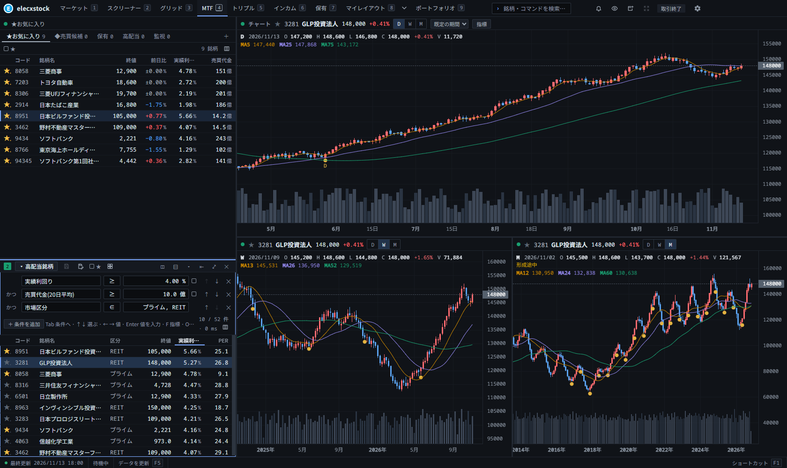
  </a>
  <br>
  ▶ <a href="https://youtu.be/PEKaSOyOSHw">デモ動画を見る / Watch the demo</a>
</p>

---

## 日本語

日本株と J-REIT のデータを手元の PC に取り込み、**チャートを並べて見比べ、条件で絞り込む**ためのデスクトップアプリです。
長期投資家向けに、日足・週足・月足（上場以来の月次系列）、実績利回り、配当の履歴を中心に作っています。
すべての操作がキーボードだけで行えます。

現在は**ベータ版**です。不具合や使いにくいところがあれば、[Issues](https://github.com/kurouna/elecxstock/issues) で知らせてください。

> **注意**
>
> - 株価・配当などのデータは **Yahoo Finance の非公式 API**（[yahoo-finance2](https://github.com/gadicc/yahoo-finance2)）から取得しています。
>   Yahoo の公式なサービスではなく、遅延・欠損・誤りがあり得ます。仕様の変更で取得できなくなることがあります。
> - **個人の利用の範囲で**お使いください。取得したデータを**再配布しないでください**。
> - 上場銘柄の一覧は日本取引所グループ（JPX）が公開している一覧（xlsx）から取り込みます。
> - 本アプリは投資助言ではありません。投資の判断はご自身の責任で行ってください。

### できること

- **ユニバース**: 東証プライムと J-REIT を自動で取得します。スタンダード・グロース・ETF などは、コマンドバーやウォッチリストから追加でき、ウォッチリストや保有に入れた銘柄も取得します。5 桁の優先株・種類株（例: 94345）にも対応しています。
- **チャート**: 日足・週足・月足、ローソク足／バー／ライン、移動平均（期間を変えられる）、出来高、ボリンジャーバンド・一目均衡表・RSI・MACD・ストキャスティクス、配当落ち日・分割の印、他銘柄との比較（%）、対数軸、分割調整／未調整／配当込み、キーボードの十字線。日・週・月を 1 ペインに並べるマルチ時間軸も。
  「設定 > チャート」で ON にすると、チャートを画像（PNG）で保存できます（既定は OFF。データは Yahoo Finance のものなので、保存した画像は個人で使う範囲にとどめ、公開・再配布しないでください）。
- **チャートグリッド**: 2×2 から 6×5 まで、多数のチャートを並べて、時間軸・期間・並べ替え・比較（期間の始点を 100%）を一度に切り替えます。売買候補に印を付けて、まとめてウォッチリストに入れられます。タイルの銘柄は C で差し替え、1〜9 で足し、Delete で外せます。
- **スクリーナー**: 利回り・配当性向・連続増配年数・配当の増配率・権利確定月・PER・PBR・ROE・EPS・BPS・時価総額・売買代金・最低投資金額・騰落率（年初来・配当込みも）・移動平均乖離・52 週と年初来の高値・安値からの位置・ゴールデンクロスからの日数・RSI・ボラティリティ・ベータ・最大下落率・決算発表や権利付最終日までの日数・保有割合・取得利回り・市場区分・33 業種・種別・お気に入り・ウォッチリストなど 58 項目で絞り込みます。項目は分類ごとに並んだダイアログから選び、打って絞り込めます（ⓘ で説明）。「かつ／または」、相対条件（終値 ≥ 75 日移動平均）、上位 N 件、列の選択、CSV 書き出し。名前を付けて保存できます。既定で 8 つのスクリーニング条件（高配当銘柄・割安（PBR 1 倍割れ・ROE 8%）・J-REIT 高利回り・52週高値圏・連続増配・10万円以下で買える高配当・低ボラティリティ・ディフェンシブ・上昇トレンドの押し目）を用意しています。項目の一覧と説明は [docs/screener-fields.md](docs/screener-fields.md)。
  最低投資金額は株式を 100 株、J-REIT を 1 口として終値から計算します。ETF・ETN などは売買の単位が分からないため出しません（欠損）。
- **銘柄情報**: 値段と 52 週の高値・安値の中での位置、移動平均からの乖離、主な指標（利回り・PER・PBR・時価総額・売買代金・最低投資金額）、決算発表と権利付最終日までの日数、配当の推移（年ごと・回ごと、5 年の増配率、連続増配・非減配）、利回りの 5 年の範囲、値動き（値段と配当込み）と最大下落率、保有していれば評価損益と取得利回り。
- **ウォッチリスト**: 複数のリスト、お気に入り（★）、並べ替え・複製、複数選択、列の選択、CSV の書き出しとコードの一覧の取り込み、JSON での書き出し・取り込み。
- **保有**: 保有タブ（Ctrl+Shift+7）で銘柄・口座区分（NISA 成長投資枠・つみたて投資枠・旧 NISA・特定・一般）・数量・平均取得単価を足す・直す・外すか、楽天証券の保有商品の CSV を取り込みます（取り込むと CSV の内容に置き換わります。国内株式）。評価額・評価損益・前日比・年間配当の見込み・取得利回りを口座区分ごと・合計で見られます。JSON で書き出し・取り込み（[形式](docs/holdings-format.md)）。
- **ポートフォリオのダッシュボード**: ポートフォリオのタブ（Ctrl+Shift+9）で、評価額・資産推移（評価額と取得額の間を含み損益の色で塗る）・資産構成（業種・17 業種・口座・種別のツリーマップ、景気敏感とディフェンシブ）・損益寄与（今日・今月・今年・取得来）・配当見込み・今後 30 日の予定を 1 枚で見られます。資産推移は % 表示で時間加重の収益率を出し、日経平均・TOPIX 連動 ETF（1306）と比べられます。← → で日を動かすと、評価額・資産構成・損益寄与がその日の値になります。項目を選ぶと、同じリンク色のチャートと銘柄情報に出ます。下の段は配当の分析（年間配当と前年比、増配・買い増し・新規・売却に分けた増減要因、分類ごとのドーナツと表）。資産の推移は日々の更新のたびに自動で記録します（[設計](docs/design-portfolio.md)）。
- **アラート**: 銘柄に条件（終値 ≤ 17,500、実績利回り ≥ 5%、終値 ≤ 75 日移動平均、保有の損益率など。最大 3 つの「かつ」）を付けるか、保存したスクリーニング条件に新しく入った銘柄を知らせます。取得のジョブの終わりに判定し、トースト・Windows の通知・トップバーのベルで知らせます。分割があってもしきい値を換算して比べ、チャートにしきい値の点線を引きます。Ctrl+Alt+A で作り、Ctrl+Alt+L の一覧と履歴から銘柄を開けます。外部への送信（メールなど）はしません。
- **マーケット**: 日本・米国・アジアの指数、為替・米国債10年利回り、原油・金・銀、ビットコインの値を 1 枚の表で見るマーケット一覧（区分のタブで絞り込み、ウォッチリストと同じ列とキー）、騰落（プライム・J-REIT の値上がり・値下がり・新高値・新安値・売買代金と、33 業種の騰落率。Enter で業種の中の銘柄へ。[設計](docs/design-breadth.md)）、33 業種のヒートマップ（面積 = 時価総額、色 = 騰落率）、ランキング、指数・指数連動 ETF の小さなチャート（[設計](docs/design-market-board.md)）。
  **TOPIX・JPX日経400・グロース250・東証REIT指数は Yahoo で取れないため、連動 ETF の値で代えています**（指数そのものの値ではありません）: TOPIX → NEXT FUNDS TOPIX連動型上場投信（1306）、JPX日経400 → NEXT FUNDS JPX日経インデックス400連動型上場投信（1591）、グロース250 → 東証グロース250ETF（2516）、東証REIT指数 → NEXT FUNDS 東証REIT指数連動型上場投信（1343）。一覧には「連動ETF」と ETF の名前を出します。値は日足の終値（取得したときの最後の足）で、リアルタイムではありません。
- **ニュース**（取るかは初回起動で選べ、設定でいつでも切れます）: マーケットのタブの左下に、日本銀行・日本取引所グループ・Bloomberg などの見出しを時刻順に並べます。見出しとリンクだけを同梱の一覧（[docs/news-feeds.md](docs/news-feeds.md)）から取り、本文・画像は取りません。分類のタブ・絞り込み（/）・Enter でブラウザで開く。Ctrl+C で選んだ見出し、Ctrl+Alt+C で表示中の見出し（100 件まで）を文字でコピーでき、別のアプリで訳したりメモしたりできます（アプリは翻訳しません）。間隔は既定 10 分（下限 5 分、0 は起動時だけ）で、ペインが見えている間だけ取ります。切るとニュースのための通信はしません。管理者はレジストリ（`HKLM\Software\Policies\elecxstock` の `News`=0）か環境変数 `ELECXSTOCK_NEWS=off` で止められます（[設計](docs/design-news.md)）。
  見出しは各配信元のものです。記事の利用は各配信元の規約に従ってください（Bloomberg などは**個人の非商用の利用**に限られます。業務の PC で読むと「非商用」から外れることがあります）。ニュースの選択はこの PC に保存し、データの書き出しには入りません（PC を移すと選び直しになります）。
- **レイアウト**: ペインの分割・入れ替え（タイトルのドラッグでも）・最大化、左右の自動で隠れるドロワー、9 つのプリセット（マーケット・スクリーナー・グリッド・MTF・トリプル・インカム・保有・マイレイアウト・ポートフォリオ）、名前を付けたページを何枚も持てるマイレイアウト（タブの ▾ で切り替え）、サイズのリセット、レイアウトを初期状態に戻す（このタブ・すべてのタブ）。ペインの種類は Ctrl+Shift+N で変えられます（チャートをスクリーナーや銘柄情報にする など）。グリッドの銘柄も含めて保存されます。一覧の行をグリッドのタイルやチャートにドラッグすると、その銘柄を表示します。ペインを最大化・戻すとき（Ctrl+Shift+Enter・Esc）は元の場所との間を短く動き、タブを替えると下線が選んだタブへ滑って中身が少し滑って入るので、どこが広がった・どこへ戻った・どちらのタブへ移ったかを目で追えます（設定の「動きを減らす」か Windows のアニメーションの設定で止まります）。F11 で窓を全画面にします。
- **マルチモニタ**: Ctrl+Alt+N（またはタイトルバーのボタン）でタブなしの「フリー」のウィンドウを最大 3 枚開き（チャートグリッド・4 分割・MTF + 銘柄情報）、2 枚目のモニタにチャートを並べられます。銘柄は 1 枚目の一覧からのドラッグか Ctrl+Alt+Enter で送ります。リンク色を付けたチャートは 1 枚目で選んだ銘柄を追います。並び・位置・文字の大きさは窓ごとに覚え、次の起動で開き直します。
- **配当カレンダー**、取得ジョブの進捗と一時停止。
- **日本語／英語**の表示、ダーク／ライトのテーマ、陽線・陰線の色（日本式／欧米式）、キーの割り当ての変更。
- **日々の更新**: 大引け後に自動で更新します。銘柄ごとに取らず一括気配でまとめて取り、日足の取得は分割の疑い・取りこぼし・定期の照合に絞ります。ウォッチリストと保有の銘柄を先に更新し、最後に取りこぼしを 1 回だけ確かめます。
- **常駐と自動起動**（どれも既定でオフ）: 閉じても通知領域で動かし続け、窓を出していなくても自動の更新とアラートを続けます。Windows へのサインインで起動し、窓を出さずに通知領域に入れておくこともできます。終了は Ctrl+Shift+Q か、通知領域のアイコンのメニューから。
- 新しい版の通知、市場データの DB のバックアップ、日足の CSV 書き出し。

|                                                  |                                                        |
| ------------------------------------------------ | ------------------------------------------------------ |
| 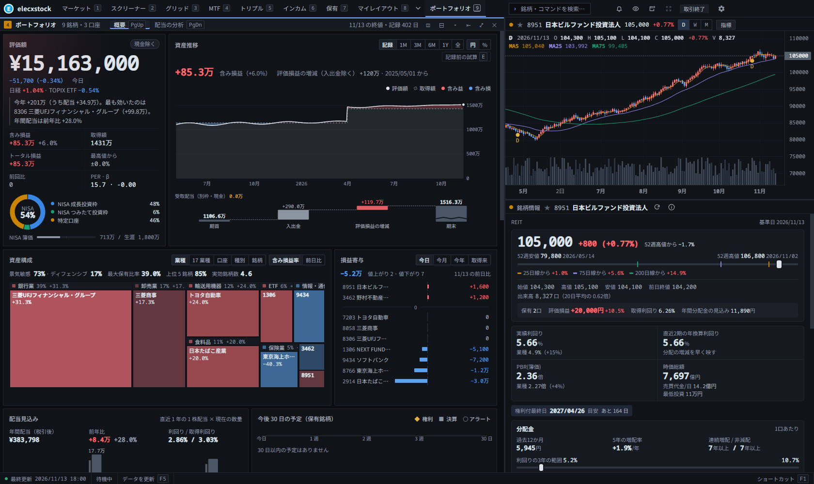         | 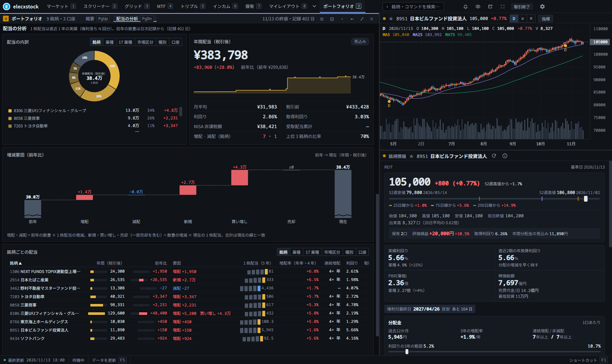 |
| ポートフォリオ（Ctrl+Shift+9）                   | ポートフォリオの配当の分析（PgDn）                     |
| 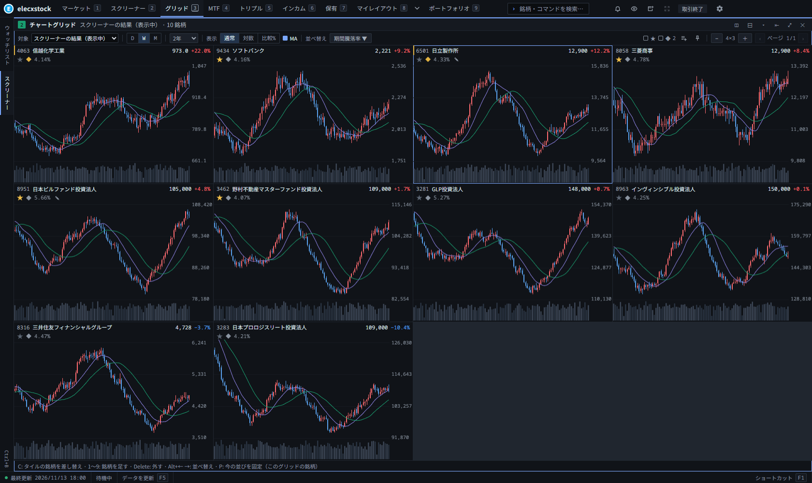               |              |
| チャートグリッド                                 | スクリーナー                                           |
| 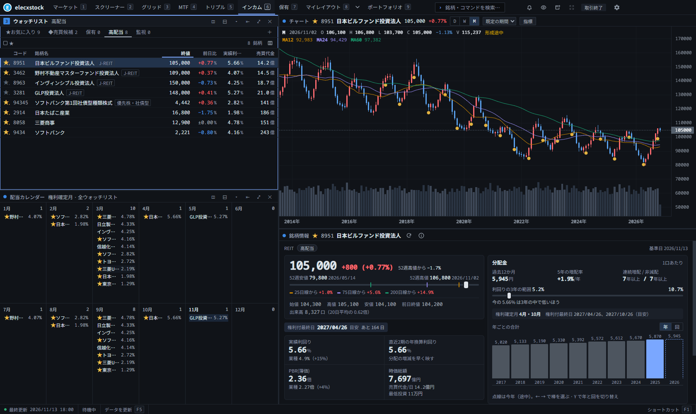           | 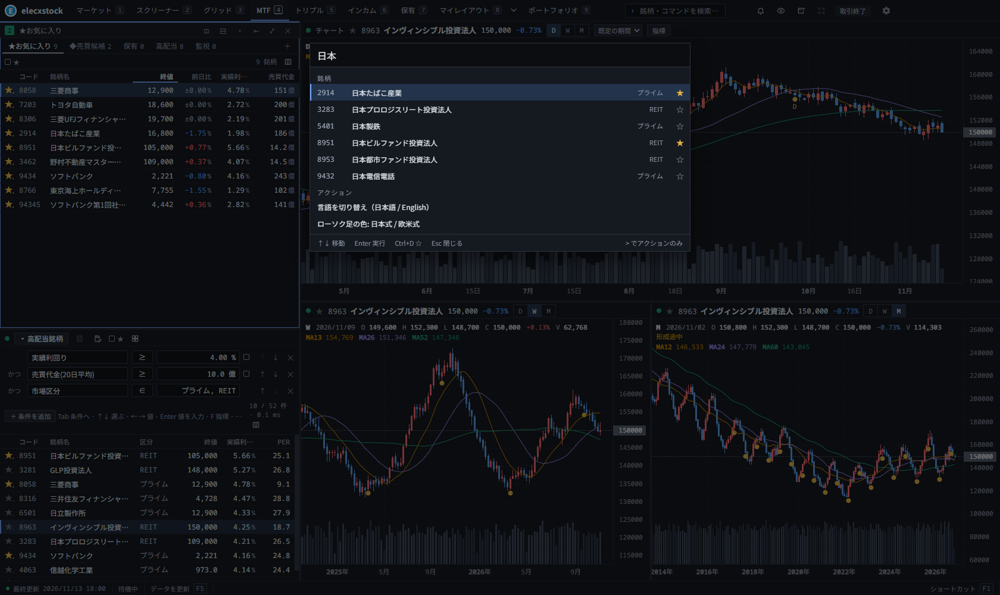           |
| インカム（配当カレンダー）                       | コマンドバー（Ctrl+K）                                 |
| 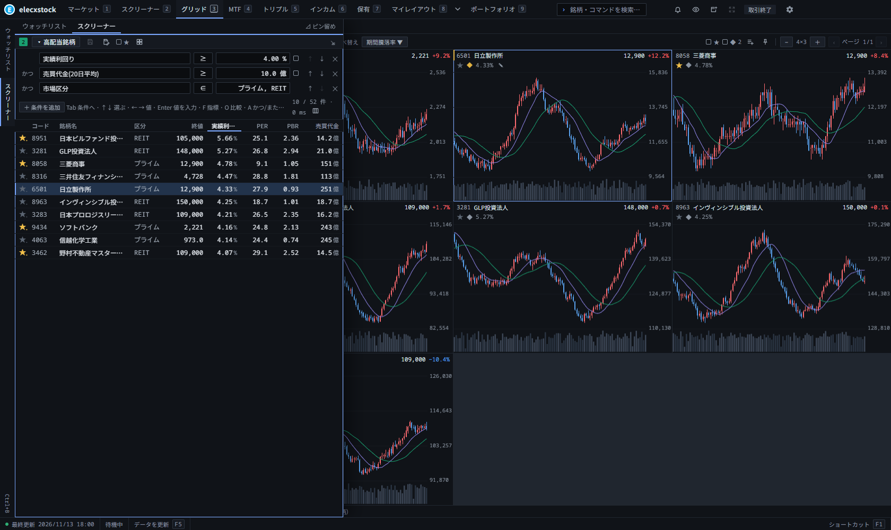      | 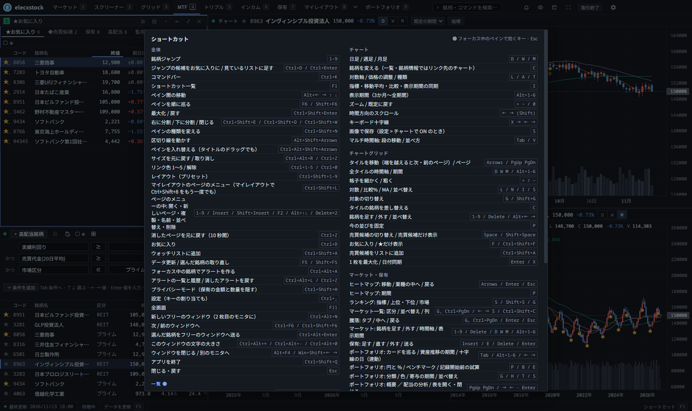                     |
| ドロワー（Ctrl+B）                               | ショートカット一覧（F1）                               |
|            |                    |
| マーケット（ヒートマップ・ランキング・ニュース） | ライトテーマ                                           |
| 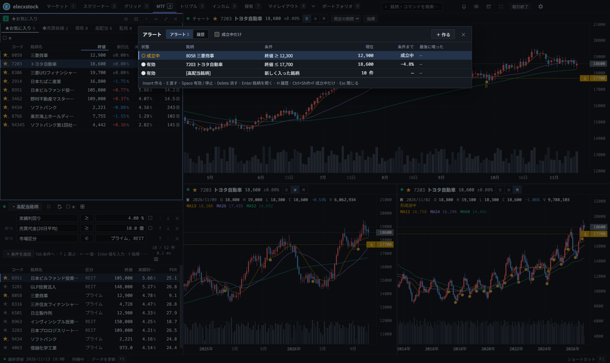           | 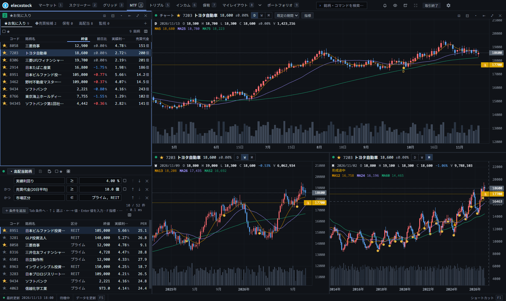         |
| アラート（Ctrl+Alt+L）                           | チャートのアラートの点線                               |
| 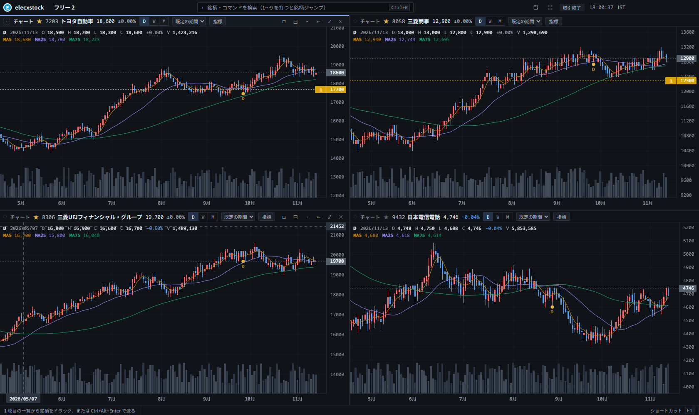        | 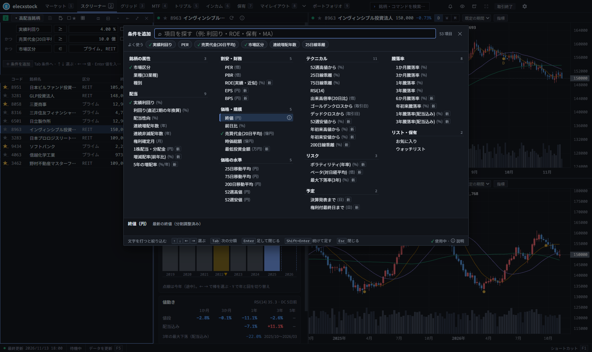           |
| フリーのウィンドウ（2 枚目のモニタ）             | スクリーナーの条件を選ぶ（Insert）                     |
| 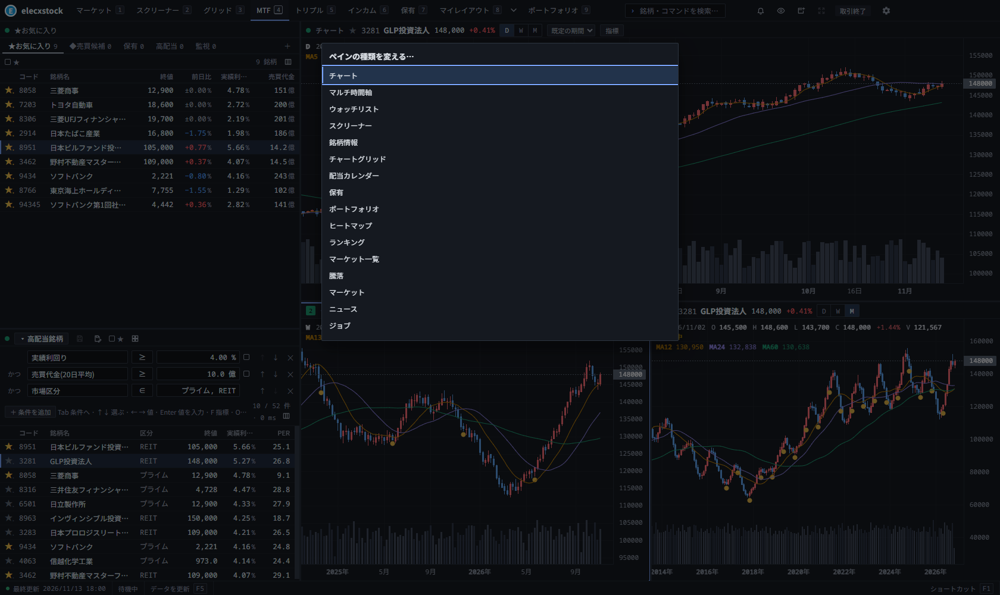        | 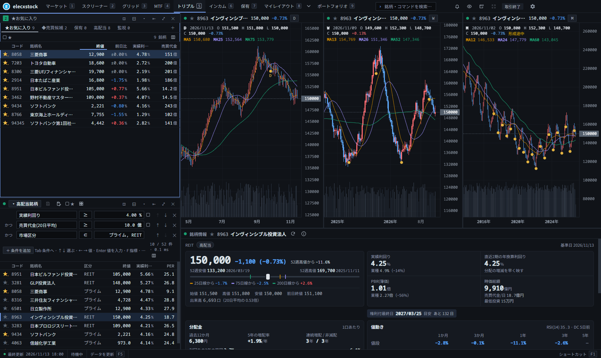                 |
| ペインの種類を変える（Ctrl+Shift+N）             | トリプル（日足・週足・月足と銘柄情報）                 |

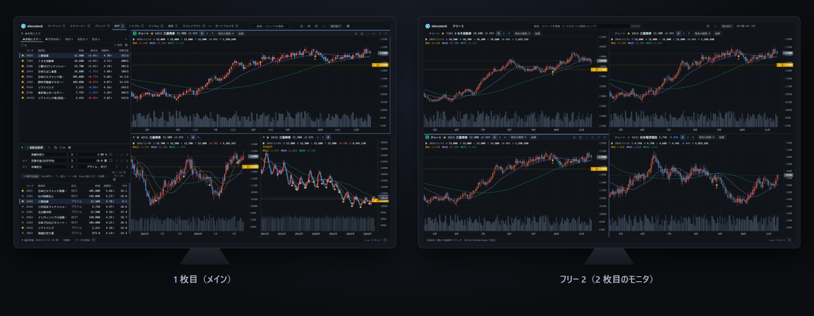

2 枚のモニタに並べたところ（左: 1 枚目、右: フリー 2。リンク 2 のチャートが 1 枚目で選んだ銘柄を追う）

（スクリーンショットの株価・利回り・配当などの値は、テスト用に乱数で作った架空のものです。銘柄名とコードは実在しますが、表示の値は実際の値とは関係ありません。実際のデータは使っていません）

### インストール

[Releases](https://github.com/kurouna/elecxstock/releases) から `elecxstock-<版>-setup.exe` をダウンロードして実行します（Windows 10/11、x64）。

- コード署名をしていないため、初回は Windows SmartScreen の警告が出ます。「詳細情報」→「実行」で進めてください。
- アプリの自動アップデートはありません。新しい版が出ると知らせるので、Releases から入れ直してください（データは残ります）。
- データは `%APPDATA%\elecxstock\data` に保存されます。アンインストール時に消すかどうかを尋ねます。
- 保有・ウォッチリスト・アラートなどの利用者のデータは、`%APPDATA%\elecxstock\` の下に**暗号化せずに**保存されます。同じ Windows ユーザーで動くほかのアプリからも読めます。守るには BitLocker などのディスク暗号化を使い、このフォルダを共有フォルダやクラウドの同期の場所（OneDrive など）に置かないでください。

初回起動で注意書きに同意すると、銘柄一覧と既定 3 年分の日足の取得が始まります（プライム + J-REIT で数十分ほど）。
取得中もアプリは使えます。以降は起動時と大引け後に差分だけを更新します。

### 主なキー

| 操作                                                      | キー                                         |
| --------------------------------------------------------- | -------------------------------------------- |
| コマンドバー（銘柄・スクリーニング条件・操作を探す）      | Ctrl+K                                       |
| 銘柄ジャンプ                                              | 数字キー（証券コード）→ Enter                |
| ジャンプの候補をお気に入りに / リストに足す               | Ctrl+D / Ctrl+Enter                          |
| ペイン間の移動                                            | Alt+← → ↑ ↓                                  |
| ペインの最大化 / 戻す                                     | Ctrl+Shift+Enter / Esc                       |
| 窓の全画面                                                | F11                                          |
| レイアウトの切り替え / マイレイアウトのページ             | Ctrl+Shift+1〜9 / Ctrl+Shift+L               |
| 左 / 右のドロワー                                         | Ctrl+B / Ctrl+Shift+B（ピン留め Ctrl+Alt+B） |
| お気に入り / リストに追加                                 | Ctrl+D / Ctrl+Shift+A                        |
| 日足 / 週足 / 月足・チャートの指標                        | D / W / M・I                                 |
| 列の選択（一覧）                                          | Ctrl+Shift+C                                 |
| ペインの種類を変える                                      | Ctrl+Shift+N                                 |
| ニュース: 開く / タブ / 絞り込み / コピー（1 件・表示中） | Enter / G / / / Ctrl+C・Ctrl+Alt+C           |
| チャート / グリッドのタイルの銘柄を変える                 | C                                            |
| データの更新                                              | F5                                           |
| アラートを作る / 一覧と履歴                               | Ctrl+Alt+A / Ctrl+Alt+L                      |
| フリーのウィンドウを開く / 窓を移る                       | Ctrl+Alt+N / Ctrl+F6                         |
| 選んだ銘柄をフリーのウィンドウへ送る                      | Ctrl+Alt+Enter                               |
| ショートカット一覧                                        | F1                                           |
| アプリを終了                                              | Ctrl+Shift+Q                                 |

すべてのキーは F1 の一覧と [docs/requirements.md](docs/requirements.md) §6.5 にあります。アプリ全体のキーは「設定 > キー」で変えられます。

### 開発

```bash
npm ci
npm run dev        # 開発サーバー + アプリ
npm run verify     # lint・型検査・単体テスト
npm run build && npx playwright test   # E2E（スタブのデータ・キーボードだけで操作）
npm run package    # Windows のインストーラ（release/）
npm run demo       # 紹介動画用のデモ（架空のデータ・キー操作で自動で進む）
npm run demo:0.1.9 # 版ごとのデモ（0.1.9: タブの切り替え・最大化の動き・F11 の全画面・ニュースのペイン）
```

ネットワークを使わずに動かすときは `ELECXSTOCK_PROVIDER=stub` を付けます。
Electron 45・Svelte 5・TypeScript・SQLite（`node:sqlite`）・Lightweight Charts で作っています。
設計は [docs/requirements.md](docs/requirements.md)、判断の記録は [docs/decisions.md](docs/decisions.md)、画面のモックは [docs/mock](docs/mock/README.md) にあります。

### ライセンス

[MIT](LICENSE)。同梱している OSS のライセンスは、インストール先の `THIRD_PARTY_NOTICES.txt` と、アプリの「設定 > このアプリについて」で見られます。
チャートは TradingView の [Lightweight Charts](https://www.tradingview.com/lightweight-charts/)（Apache-2.0）を使っています。

> TradingView Lightweight Charts™<br>
> Copyright (с) 2025 TradingView, Inc. https://www.tradingview.com/

### 関連

[elecxstock-cli](https://github.com/kurouna/elecxstock-cli) は、elecxstock が取り込んだデータをターミナルで `top` のように眺める、読み取り専用の CUI です（Windows の単一実行ファイル）。

---

## English

A desktop app that keeps Japanese equity and J-REIT data on your PC so you can **compare many charts side by side and screen by conditions**.
It is built for long-term investors: daily, weekly and monthly bars (a monthly series since listing), trailing yield and dividend history.
Everything can be done with the keyboard alone.

This is a **beta**. Please report bugs and rough edges in [Issues](https://github.com/kurouna/elecxstock/issues).

> **Notice**
>
> - Prices and dividends come from the **unofficial Yahoo Finance API** (via [yahoo-finance2](https://github.com/gadicc/yahoo-finance2)).
>   It is not an official Yahoo service; data may be delayed, missing or wrong, and may stop working if Yahoo changes it.
> - Use it **for personal use only**. **Do not redistribute** the downloaded data.
> - The list of listed issues is imported from the spreadsheet published by Japan Exchange Group (JPX).
> - This app is not investment advice.

### Features

- **Universe**: TSE Prime and J-REITs are fetched automatically. Standard, Growth, ETFs and others can be added from the command bar or a watchlist, and symbols in your watchlists and holdings are fetched too. Five-character codes for preferred and class shares (e.g. 94345) are supported.
- **Charts**: daily / weekly / monthly, candles / bars / line, configurable moving averages, volume, Bollinger Bands, Ichimoku, RSI, MACD, stochastics, dividend and split markers, comparison (%), log scale, split-adjusted / unadjusted / total-return prices, keyboard crosshair, and a multi-timeframe pane.
  Turn on "Save chart images" in Settings > Charts to save a chart as a PNG (off by default; the data comes from Yahoo Finance, so keep saved images for personal use and do not publish or redistribute them).
- **Chart grid**: 2×2 up to 6×5 tiles; switch timeframe, period, sort order and compare mode (rebased to 100%) for all tiles at once. Mark candidates and send them to a watchlist. Replace a tile's symbol with C.
- **Screener**: 58 fields, including yield, payout, dividend streaks and growth, record month, P/E, P/B, ROE, EPS, BPS, market cap, turnover, minimum investment, returns (year-to-date and total return too), MA deviation, position against the 52-week and year-to-date high and low, days since a golden cross, RSI, volatility, beta, max drawdown, days to earnings and to the last cum-rights day, portfolio weight, yield on cost, market, TSE 33 sectors, type, favorites and watchlists. Pick fields from a dialog grouped by category, with type-to-filter and ⓘ descriptions. And/or groups, relative conditions, top N, column chooser, CSV. Save screens by name. Eight default screens are included: high yield, value (P/B < 1, ROE ≥ 8%), J-REIT high yield, near the 52-week high, dividend growers, high yield under ¥100k, low volatility, and pullback in an uptrend. All fields are listed in [docs/screener-fields.md](docs/screener-fields.md).
  Minimum investment is the close × 100 shares for stocks and × 1 unit for J-REITs. It is not shown for ETFs, ETNs and others, whose trading unit is unknown.
- **Symbol info**: price and its place in the 52-week range, deviation from moving averages, key figures (yield, P/E, P/B, market cap, turnover, minimum investment), days to earnings and to the last cum-rights day, dividend history (per year or per payout, 5-year growth, growth and no-cut streaks), the 5-year yield range, returns (price and total return) and max drawdown, and your P/L and yield on cost if you hold it.
- **Watchlists**: multiple lists, favorites (★), sorting, duplicate, multi-select, columns, CSV export and code-list import, JSON export/import.
- **Holdings**: on the Holdings tab (Ctrl+Shift+7), add, edit or remove holdings by symbol, account type (NISA growth / tsumitate / old NISA, specified, general), quantity and average cost, or import the Rakuten Securities holdings CSV (domestic stocks; the import replaces the holdings). See value, P/L, day change, expected annual dividends and yield on cost by account and in total; JSON export/import ([format](docs/holdings-format.md)).
- **Portfolio dashboard**: the Portfolio tab (Ctrl+Shift+9) shows market value, the asset history (filled between value and cost in the color of unrealized P/L), allocation (a treemap by sector, TOPIX-17 sector, account or kind, with cyclical vs defensive), contribution (today, this month, this year, since purchase), the dividend outlook and the next 30 days of events on one page. The history is recorded automatically with every daily update; switch it to % for an approximate time-weighted return and compare it with the Nikkei 225 or the TOPIX ETF (1306), and move the day with ← → to see that day's allocation and contribution. The lower section analyzes dividends: annual amount and year-on-year change, a waterfall of raises, cuts, new, added and sold, and a breakdown donut and table. Selecting an item shows it on the chart and symbol info with the same link color ([design, Japanese](docs/design-portfolio.md)).
- **Alerts**: put conditions on a symbol (close ≤ 17,500, trailing yield ≥ 5%, close ≤ 75-day MA, P/L of a holding and so on; up to three, all must hold), or get notified of symbols that newly match a saved screen. Alerts are evaluated when a fetch job ends and shown as a toast, a Windows notification and a badge on the bell. Price thresholds are converted across stock splits, and drawn as dashed lines on charts. Create with Ctrl+Alt+A; open the list and history with Ctrl+Alt+L. Nothing is sent outside the app (no e-mail).
- **Market**: a market board with Japanese, US and Asian indices, FX and the US 10-year yield, oil, gold, silver and Bitcoin in one table (filter by group with tabs; same columns and keys as watchlists), market breadth (advancers, decliners, new highs and lows and turnover for Prime and J-REITs, and returns by TSE 33 sector; press Enter to list a sector's stocks), a sector heatmap, rankings and index mini-charts.
  **TOPIX, JPX-Nikkei 400, Growth 250 and the TSE REIT Index are not available from Yahoo, so the board shows tracking ETFs instead** (not the index values): NEXT FUNDS TOPIX ETF (1306), NEXT FUNDS JPX-Nikkei Index 400 ETF (1591), TSE Growth 250 ETF (2516) and NEXT FUNDS REIT INDEX ETF (1343), labeled as ETFs. Values are daily closes (the latest bar at fetch time), not real-time.
- **News** (you choose at first run; can be turned off any time in Settings): headlines from the Bank of Japan, JPX, Bloomberg and other built-in sources ([list](docs/news-feeds.md)) in time order at the bottom left of the Market tab. Only headlines and links are fetched, no article bodies or images. Category tabs, filter (/), Enter opens the article in your browser. Ctrl+C copies the selected headline and Ctrl+Alt+C the shown headlines (up to 100) as text, so you can translate or note them in another app (the app does not translate). Checked every 10 minutes by default (minimum 5, 0 = at startup only), only while the pane is visible. When off, no requests are made for news. Administrators can turn it off with the registry (`News`=0 under `HKLM\Software\Policies\elecxstock`) or `ELECXSTOCK_NEWS=off`. Headlines belong to each source; use articles under each source's terms (Bloomberg and others allow personal, non-commercial use only).
- **Layouts**: split, swap (or drag titles) and maximize panes, left and right auto-hiding drawers, nine presets (Market, Screener, Grid, MTF, Triple, Income, Holdings, Pages, where each unlinked chart keeps its own symbol, and Portfolio), any number of named pages in the Pages tab (switch with the ▾ next to the tab), size reset, and resetting the layout of this tab or all tabs. Change a pane into another kind with Ctrl+Shift+N (e.g. a chart into a screener or symbol info). Grid symbols are saved with the layout. Drag a row from a list onto a grid tile or chart to show that symbol. Maximizing and restoring a pane (Ctrl+Shift+Enter, Esc) moves briefly between the pane and its place, and switching tabs slides the underline to the new tab and the content in slightly, so you can follow what grew, where it went back and which tab you moved to (turned off by "Reduce motion" in Settings or the Windows animation setting). F11 makes the window full screen.
- **Multiple monitors**: open up to three tabless Free windows with Ctrl+Alt+N or the title-bar button (chart grid, four charts, or MTF + symbol info) to line up charts on a second monitor. Drag symbols from the main window's lists or send them with Ctrl+Alt+Enter; linked charts follow the symbol picked in the main window. Layout, position and text size are remembered per window and reopened at the next start.
- **Dividend calendar**, fetch jobs with progress and pause.
- **Japanese / English** UI, dark / light themes, candle colors (Japanese or Western) and remappable keys.
- **Daily update** after the close: quotes are fetched in bulk instead of per symbol, and daily bars are fetched only for suspected splits, missed days and a rotating check. Symbols in your watchlists and holdings are updated first, and one final pass re-fetches anything missed.
- **Keep running and start at sign-in** (all off by default): closing the window can keep elecxstock running in the notification area, so automatic updates and alerts go on without a window. It can also start when you sign in to Windows, optionally without showing the window. Quit with Ctrl+Shift+Q or from the icon menu.
- New-version notice, database backup, daily-bar CSV export.


|                                          |                                                        |
| ---------------------------------------- | ------------------------------------------------------ |
|  |  |
| Portfolio tab (Japanese UI)              | Dividend analysis (Japanese UI)                        |

(Prices, yields, dividends and other values in the screenshots are fictitious, generated at random for testing. Company names and codes are real, but the values shown have nothing to do with actual market data. No real market data is used.)

### Install

Download `elecxstock-<version>-setup.exe` from [Releases](https://github.com/kurouna/elecxstock/releases) (Windows 10/11, x64).
The installer is not code-signed, so SmartScreen warns on first run ("More info" → "Run anyway"). There is no auto-update; the app tells you when a new version is out.
Data is stored in `%APPDATA%\elecxstock\data`.
Your holdings, watchlists and alerts are stored **unencrypted** under `%APPDATA%\elecxstock\`, so any app running as the same Windows user can read them. To protect them, use disk encryption such as BitLocker, and do not put this folder in a shared or synced location (such as OneDrive).

### Development

```bash
npm ci
npm run dev
npm run verify
npm run build && npx playwright test
```

Set `ELECXSTOCK_PROVIDER=stub` to run without the network. See [docs/requirements.md](docs/requirements.md) (Japanese) for the specification.

### License

[MIT](LICENSE). Licenses of bundled open-source software are in `THIRD_PARTY_NOTICES.txt` next to the executable and in Settings > About.
Charts by TradingView [Lightweight Charts](https://www.tradingview.com/lightweight-charts/) (Apache-2.0).

> TradingView Lightweight Charts™<br>
> Copyright (с) 2025 TradingView, Inc. https://www.tradingview.com/

### Related

[elecxstock-cli](https://github.com/kurouna/elecxstock-cli) is a read-only, `top`-like terminal UI for the data elecxstock keeps on your PC (a single Windows executable).
