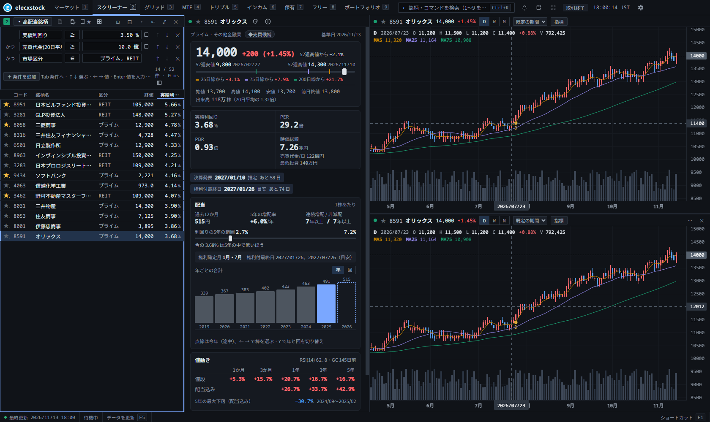
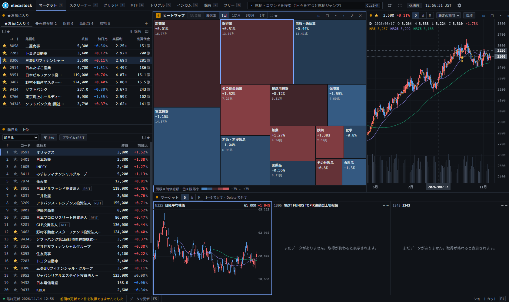
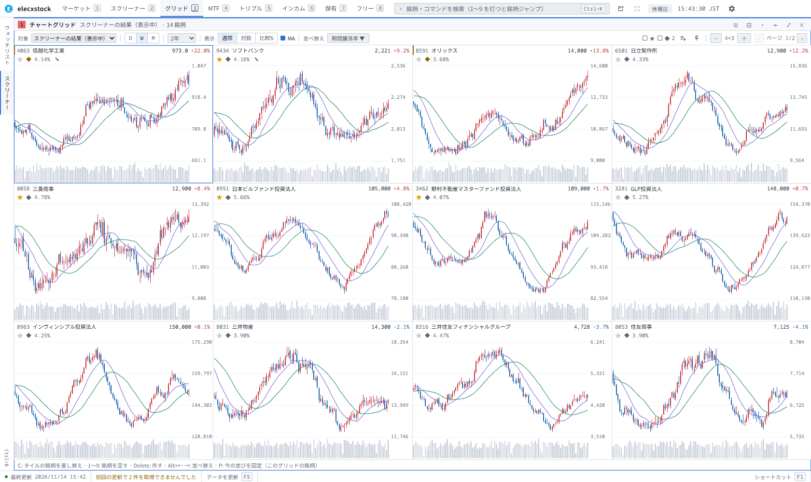
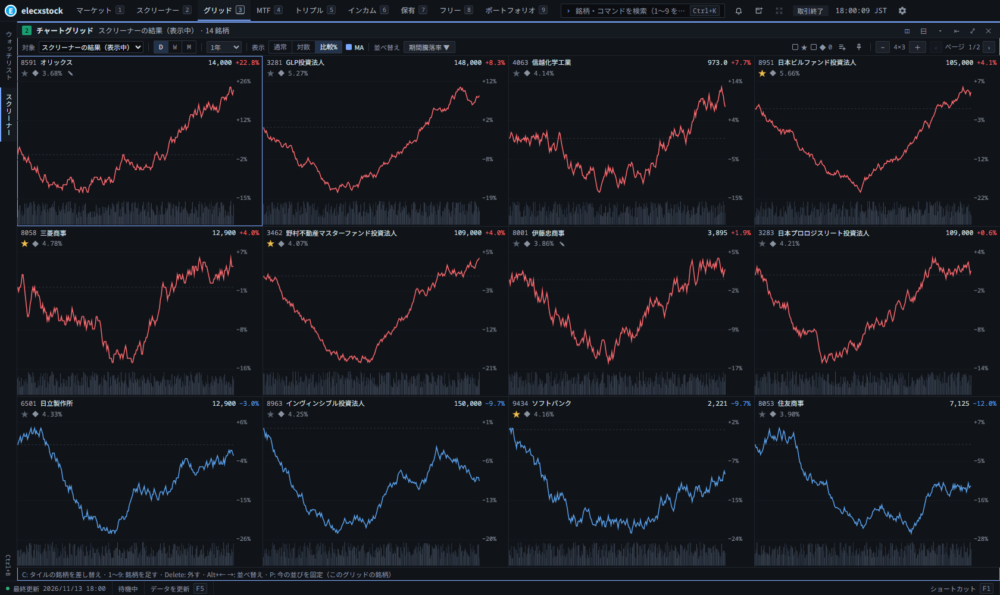

# elecxstock

[日本語](#日本語) | [English](#english)


---

## 日本語

日本株と J-REIT のデータを手元の PC に取り込み、**チャートを並べて見比べ、条件で絞り込む**ためのデスクトップアプリです。
長期投資家向けに、日足・週足・月足（上場以来の月次系列）、実績利回り、配当の履歴を中心に作っています。
すべての操作がキーボードだけで行えます。

> **注意**
>
> - 株価・配当などのデータは **Yahoo Finance の非公式 API**（[yahoo-finance2](https://github.com/gadicc/yahoo-finance2)）から取得しています。
>   Yahoo の公式なサービスではなく、遅延・欠損・誤りがあり得ます。仕様の変更で取得できなくなることがあります。
> - **個人の利用の範囲で**お使いください。取得したデータを**再配布しないでください**。
> - 上場銘柄の一覧は日本取引所グループ（JPX）が公開している一覧（xlsx）から取り込みます。
> - 本アプリは投資助言ではありません。投資の判断はご自身の責任で行ってください。

### できること

- **ユニバース**: 東証プライムと J-REIT を自動で取得します。スタンダード・グロース・ETF などは、コマンドバーやウォッチリストから追加できます。
- **チャート**: 日足・週足・月足、ローソク足／バー／ライン、移動平均（期間を変えられる）、出来高、ボリンジャーバンド・一目均衡表・RSI・MACD・ストキャスティクス、配当落ち日・分割の印、他銘柄との比較（%）、対数軸、分割調整／未調整／配当込み、キーボードの十字線。日・週・月を 1 ペインに並べるマルチ時間軸も。
- **チャートグリッド**: 2×2 から 6×5 まで、多数のチャートを並べて、時間軸・期間・並べ替え・比較（期間の始点を 100%）を一度に切り替えます。売買候補に印を付けて、まとめてウォッチリストに入れられます。タイルの銘柄は C で差し替え、1〜9 で足し、Delete で外せます。
- **スクリーナー**: 利回り・配当性向・連続増配年数・権利確定月・PER・PBR・時価総額・売買代金・騰落率・移動平均乖離・ゴールデンクロスからの日数・RSI・52 週高値からの下落率・市場区分・33 業種・種別・お気に入り・ウォッチリストで絞り込みます。「かつ／または」、相対条件（終値 ≥ 75 日移動平均）、上位 N 件、列の選択、CSV 書き出し。名前を付けて保存できます（例:「高配当銘柄」）。
- **ウォッチリスト**: 複数のリスト、お気に入り（★）、並べ替え・複製、複数選択、列の選択、CSV の書き出しとコードの一覧の取り込み、JSON での書き出し・取り込み。
- **保有（ポートフォリオ）**: 銘柄 × 口座区分（NISA 成長投資枠・つみたて投資枠・旧 NISA・特定・一般）ごとに、取引か数量・平均取得単価で記録し、評価額・評価損益・取得利回りを口座区分ごと・合計で見られます。JSON で書き出し・取り込み（[形式](docs/holdings-format.md)）。
- **マーケット**: 33 業種のヒートマップ（面積 = 時価総額、色 = 騰落率）、ランキング、指数・指数連動 ETF の小さなチャート。
- **レイアウト**: ペインの分割・入れ替え（タイトルのドラッグでも）・最大化、左右の自動で隠れるドロワー、7 つのプリセット（MTF・Grid・Screener・Income・Triple・Market・Free）、名前を付けて保存したレイアウト、サイズのリセット。グリッドの銘柄も含めて保存されます。一覧の行をグリッドのタイルやチャートにドラッグすると、その銘柄を表示します。
- **配当カレンダー**、銘柄情報、取得ジョブの進捗と一時停止。
- **日本語／英語**の表示、ダーク／ライトのテーマ、陽線・陰線の色（日本式／欧米式）、キーの割り当ての変更。
- 大引け後の自動更新、新しい版の通知、市場データの DB のバックアップ、日足の CSV 書き出し。

|                                             |                                              |
| ------------------------------------------- | -------------------------------------------- |
|           |    |
| チャートグリッド                            | スクリーナー                                 |
|       |  |
| インカム（配当カレンダー）                  | コマンドバー（Ctrl+K）                       |
|  |            |
| ドロワー（Ctrl+B）                          | ショートカット一覧（F1）                     |
|       |          |
| マーケット（ヒートマップ・ランキング）      | ライトテーマ                                 |

（スクリーンショットはテスト用の架空のデータです）

### インストール

[Releases](https://github.com/kurouna/elecxstock/releases) から `elecxstock-<版>-setup.exe` をダウンロードして実行します（Windows 10/11、x64）。

- コード署名をしていないため、初回は Windows SmartScreen の警告が出ます。「詳細情報」→「実行」で進めてください。
- アプリの自動アップデートはありません。新しい版が出ると知らせるので、Releases から入れ直してください（データは残ります）。
- データは `%APPDATA%\elecxstock\data` に保存されます。アンインストール時に消すかどうかを尋ねます。

初回起動で注意書きに同意すると、銘柄一覧と既定 5 年分の日足の取得が始まります（プライム + J-REIT で数十分ほど）。
取得中もアプリは使えます。以降は起動時と大引け後に差分だけを更新します。

### 主なキー

| 操作                                         | キー                                         |
| -------------------------------------------- | -------------------------------------------- |
| コマンドバー（銘柄・スクリーン・操作を探す） | Ctrl+K                                       |
| 銘柄ジャンプ                                 | 数字キー（証券コード）→ Enter                |
| ジャンプの候補をお気に入りに / リストに足す  | Ctrl+D / Ctrl+Enter                          |
| ペイン間の移動                               | Alt+← → ↑ ↓                                  |
| レイアウトの切り替え / 一覧                  | Ctrl+Shift+1〜7 / Ctrl+Shift+L               |
| 左 / 右のドロワー                            | Ctrl+B / Ctrl+Shift+B（ピン留め Ctrl+Alt+B） |
| お気に入り / リストに追加                    | Ctrl+D / Ctrl+Shift+A                        |
| 日足 / 週足 / 月足・チャートの指標           | D / W / M・I                                 |
| 列の選択（一覧）                             | Ctrl+Shift+C                                 |
| チャート / グリッドのタイルの銘柄を変える    | C                                            |
| データの更新                                 | F5                                           |
| ショートカット一覧                           | F1                                           |
| アプリを終了                                 | Ctrl+Shift+Q                                 |

すべてのキーは F1 の一覧と [docs/requirements.md](docs/requirements.md) §6.5 にあります。アプリ全体のキーは「設定 > キー」で変えられます。

### 開発

```bash
npm ci
npm run dev        # 開発サーバー + アプリ
npm run verify     # lint・型検査・単体テスト
npm run build && npx playwright test   # E2E（スタブのデータ・キーボードだけで操作）
npm run package    # Windows のインストーラ（release/）
```

ネットワークを使わずに動かすときは `ELECXSTOCK_PROVIDER=stub` を付けます。
Electron 45・Svelte 5・TypeScript・SQLite（`node:sqlite`）・Lightweight Charts で作っています。
設計は [docs/requirements.md](docs/requirements.md)、判断の記録は [docs/decisions.md](docs/decisions.md)、画面のモックは [docs/mock](docs/mock/README.md) にあります。

### ライセンス

[MIT](LICENSE)。同梱している OSS のライセンスは、インストール先の `THIRD_PARTY_NOTICES.txt` と、アプリの「設定 > このアプリについて」で見られます。
チャートは TradingView の [Lightweight Charts](https://www.tradingview.com/lightweight-charts/)（Apache-2.0）を使っています。

---

## English

A desktop app that keeps Japanese equity and J-REIT data on your PC so you can **compare many charts side by side and screen by conditions**.
It is built for long-term investors: daily, weekly and monthly bars (a monthly series since listing), trailing yield and dividend history.
Everything can be done with the keyboard alone.

> **Notice**
>
> - Prices and dividends come from the **unofficial Yahoo Finance API** (via [yahoo-finance2](https://github.com/gadicc/yahoo-finance2)).
>   It is not an official Yahoo service; data may be delayed, missing or wrong, and may stop working if Yahoo changes it.
> - Use it **for personal use only**. **Do not redistribute** the downloaded data.
> - The list of listed issues is imported from the spreadsheet published by Japan Exchange Group (JPX).
> - This app is not investment advice.

### Features

- **Universe**: TSE Prime and J-REITs are fetched automatically. Standard, Growth, ETFs and others can be added from the command bar or a watchlist.
- **Charts**: daily / weekly / monthly, candles / bars / line, configurable moving averages, volume, Bollinger Bands, Ichimoku, RSI, MACD, stochastics, dividend and split markers, comparison (%), log scale, split-adjusted / unadjusted / total-return prices, keyboard crosshair, and a multi-timeframe pane.
- **Chart grid**: 2×2 up to 6×5 tiles; switch timeframe, period, sort order and compare mode (rebased to 100%) for all tiles at once. Mark candidates and send them to a watchlist. Replace a tile's symbol with C.
- **Screener**: yield, payout, dividend streaks, record month, P/E, P/B, market cap, turnover, returns, MA deviation, days since a golden cross, RSI, distance from the 52-week high, market, TSE 33 sectors, type, favorites and watchlists; and/or groups, relative conditions, top N, column chooser, CSV. Save screens by name.
- **Watchlists**: multiple lists, favorites (★), sorting, duplicate, multi-select, columns, CSV export and code-list import, JSON export/import.
- **Portfolio**: holdings per symbol and account type (NISA, specified, general) entered as trades or quantity/average cost, with value and P/L by account; JSON export/import ([format](docs/holdings-format.md)).
- **Market**: sector heatmap, rankings and index mini-charts.
- **Layouts**: split, swap (or drag titles) and maximize panes, left and right auto-hiding drawers, seven presets (including Free, where each unlinked chart keeps its own symbol), named layouts, size reset. Grid symbols are saved with the layout. Drag a row from a list onto a grid tile or chart to show that symbol.
- **Dividend calendar**, symbol info, fetch jobs with progress and pause.
- **Japanese / English** UI, dark / light themes, candle colors (Japanese or Western) and remappable keys.
- Automatic update after the close, new-version notice, database backup, daily-bar CSV export.



(Screenshots use fictitious test data.)

### Install

Download `elecxstock-<version>-setup.exe` from [Releases](https://github.com/kurouna/elecxstock/releases) (Windows 10/11, x64).
The installer is not code-signed, so SmartScreen warns on first run ("More info" → "Run anyway"). There is no auto-update; the app tells you when a new version is out.
Data is stored in `%APPDATA%\elecxstock\data`.

### Development

```bash
npm ci
npm run dev
npm run verify
npm run build && npx playwright test
```

Set `ELECXSTOCK_PROVIDER=stub` to run without the network. See [docs/requirements.md](docs/requirements.md) (Japanese) for the specification.

### License

[MIT](LICENSE). Licenses of bundled open-source software are in `THIRD_PARTY_NOTICES.txt` next to the executable and in Settings > About.
Charts by TradingView [Lightweight Charts](https://www.tradingview.com/lightweight-charts/) (Apache-2.0).
